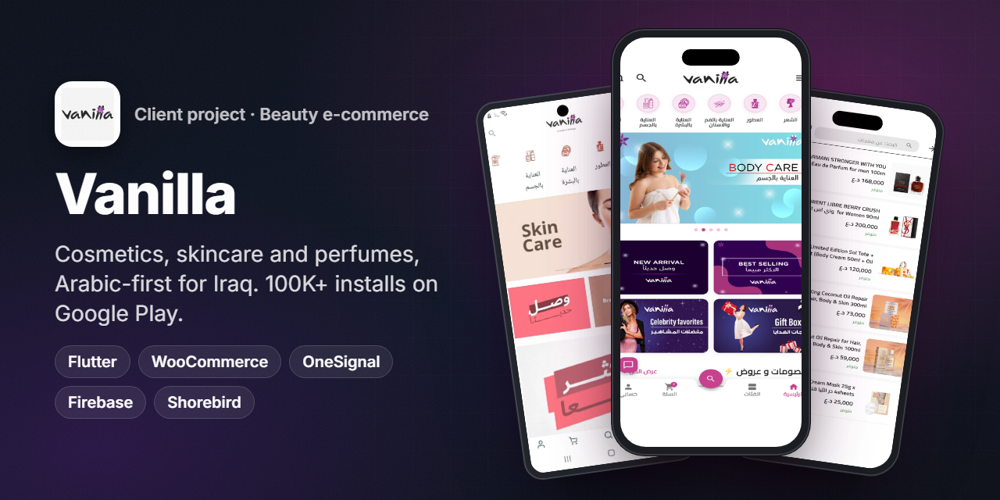
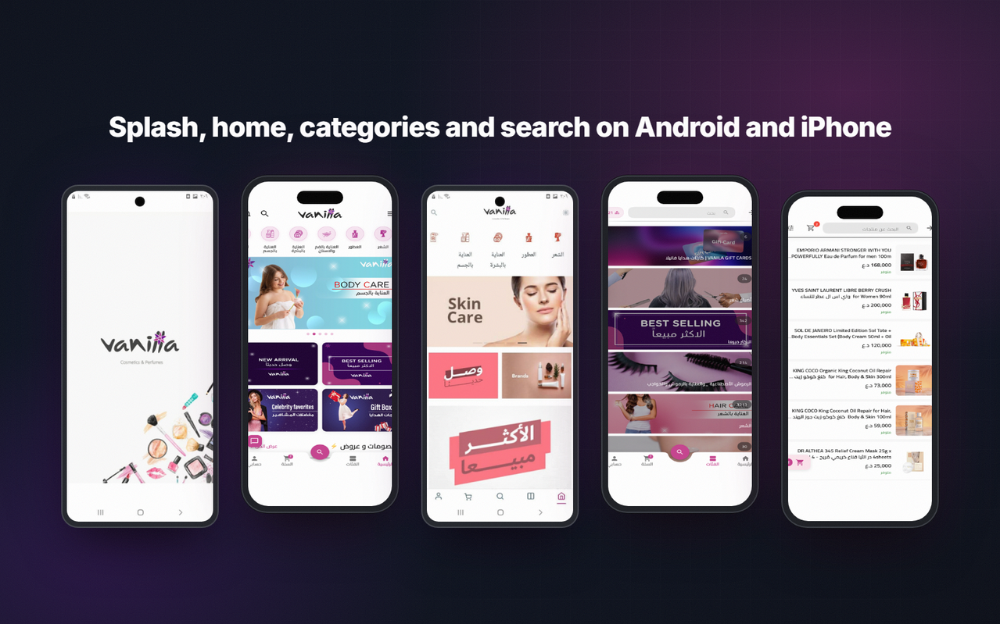
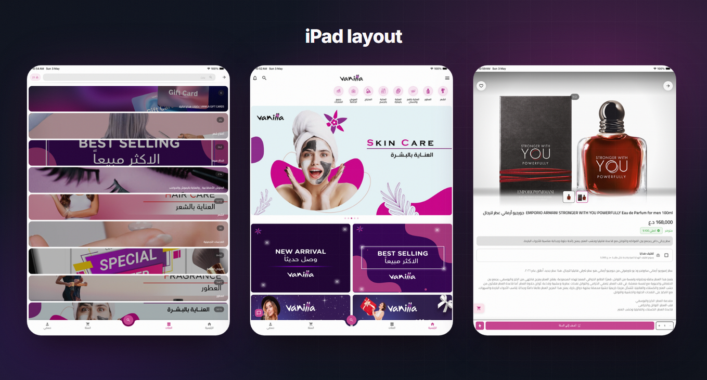
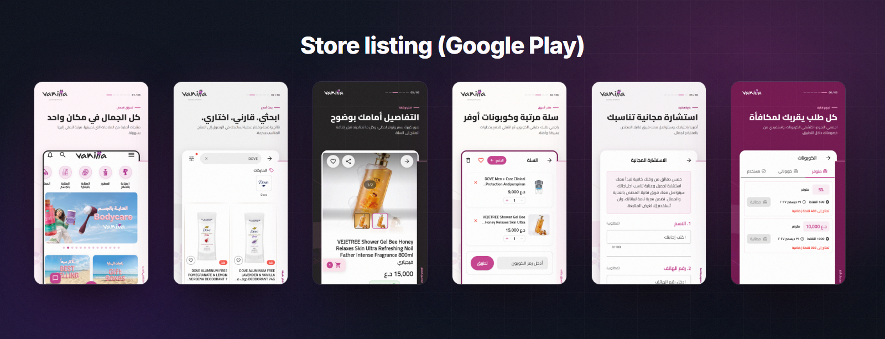
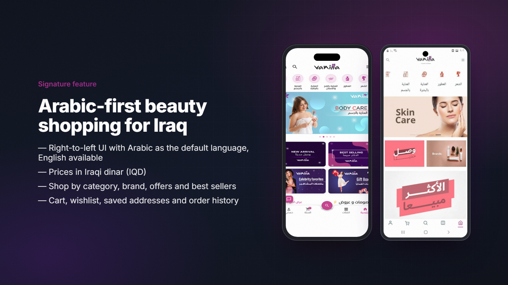
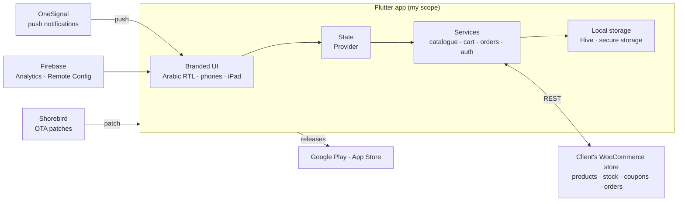

<h1 align="center">Vanilla · ڤانيلا</h1>

<b>A cosmetics and beauty shopping app for Iraq. It is Arabic-first, runs on Android, iPhone and iPad, and has 100K+ installs on Google Play.</b>

  
  
  
  
  
  
  
   
  
  

> ℹ️ Client project — source code is proprietary and not included.

## Overview

**Vanilla (ڤانيلا)** is an online cosmetics and beauty store for customers in **Iraq**. Shoppers browse makeup, skincare, haircare, perfumes, body care and gift boxes. They can filter by category or brand, follow offers and best sellers, and order from inside the app. Prices are in Iraqi dinar, and Arabic is the default language.

**My role was full mobile delivery.** That covered:

- brand customization of the storefront (colors, typography, home layout, category icons, banners and splash)
- an Arabic-first, right-to-left shopping experience tuned for the Iraqi market
- integration with the client's WooCommerce store for products, cart, checkout, orders and addresses
- push notifications, analytics and deep links
- store releases on Google Play and the App Store (iPhone and iPad), plus over-the-air updates

The iOS app has been on the App Store since March 2023.

## The challenge

- **A big catalogue on a small screen.** Thousands of products across many categories and brands have to be easy to find in Arabic, with fast search and clear filters.
- **One store, one source of truth.** The client runs the shop in WooCommerce. Products, stock, prices, coupons and orders must stay in sync with it, with no second admin panel.
- **Arabic-first for Iraq.** RTL layouts, Arabic copy and dinar prices are the default, not an afterthought. English must still work.
- **It has to look like Vanilla.** It needs its own colors, banners, category art and home sections, not a generic storefront look.
- **Frequent campaigns.** Offers, new arrivals and seasonal gift boxes change often. Fixes need to reach users without waiting for a store review.

## Highlights

**🛍️ Shopping**
- Home built from brand sections: hero banners, new arrivals, best sellers, celebrity favourites, gift boxes and offers.
- Category browsing (makeup, skincare, haircare, perfumes, body care and more) and a brands page.
- Fast search with filters and sorting, and detailed product pages with image galleries and stock status.

**🧺 Cart and orders**
- Cart with quantity controls, coupon codes and a clear order summary.
- Wishlist, saved addresses and order history with order status.
- Gift cards sold through the store.

**🌍 Arabic-first UX**
- Right-to-left UI with Arabic as the default language and English available.
- Prices shown in Iraqi dinar (IQD).
- Layouts that adapt from phones to iPad.

**📣 Engagement and delivery**
- Push notifications for offers and order updates through OneSignal.
- Firebase Analytics and Remote Config, deep links for campaigns, and in-app rating and update prompts.
- Over-the-air patches with Shorebird between store releases.

## Screens

Splash, home, categories and search on Android and iPhone.

iPad layout: category list, home and a product page.

Google Play listing: one place for beauty, search and compare, product details, cart and coupons, free consultation, and rewards.

## Signature feature: Arabic-first beauty shopping for Iraq

The whole app is designed around how customers in Iraq shop for beauty products.

1. **Arabic by default.** The app opens in Arabic with a full right-to-left layout. Navigation, product cards, cart and checkout all mirror correctly. English is one tap away in settings.
2. **Local pricing.** Every price, discount and order total is shown in Iraqi dinar, the way customers see it in the physical store.
3. **Shop the way people browse.** The home screen is built from the brand's own sections (new arrivals, best sellers, celebrity favourites, gift boxes), and each category has its own artwork. Customers can also start from a brand.
4. **Always in sync with the store.** Products, stock, prices and coupons come live from the client's WooCommerce shop, so a change in the shop's admin shows up in the app right away.

## Architecture & stack

| Layer | Tech |
|---|---|
| UI | Flutter 3.24, custom Vanilla theme and assets, Arabic RTL, responsive layouts for phones and iPad |
| State | `provider` with `get_it` for service lookup |
| Backend | The client's WooCommerce store over its REST API (catalogue, cart, checkout, coupons, orders, addresses) |
| Networking | `dio` and `http` |
| Storage | `hive` for local cache and `flutter_secure_storage` for session data |
| Notifications | OneSignal and `flutter_local_notifications` |
| Analytics & config | Firebase Analytics and Remote Config |
| Growth | Deep links for campaigns, in-app rating prompts, in-app update prompts on Android |
| Delivery | Google Play and App Store releases, Shorebird over-the-air patches |

## Engineering notes

- **Brand customization without losing upgradeability.** The Vanilla look (theme, fonts, home sections, category icons, banners and splash) is kept in configuration and assets. That keeps the core app easy to update while the brand stays consistent.
- **RTL done properly.** Lists, sliders, product cards, badges and price rows were checked in both directions. Arabic is the default, and mixed Arabic and English product names render cleanly.
- **Store sync.** The app reads products, stock and coupons from WooCommerce on demand and caches what it can locally. The shop team keeps working in the admin they already know.
- **Push that reaches users.** OneSignal is wired for offer campaigns and order updates on both Android and iOS, including the iOS notification permission flow.
- **Shipping fast.** Store releases go out through Google Play and the App Store. Small fixes ship as Shorebird patches, so a campaign doesn't wait on store review.

## Results

- **Google Play:** 100K+ installs, rated **4.4** ([com.vanilia.vanilia](https://play.google.com/store/apps/details?id=com.vanilia.vanilia)).
- **App Store:** rated **4.3** from 83 ratings, available on iPhone and iPad, listed since March 2023 ([Vanilla cosmetics](https://apps.apple.com/sa/app/vanilla-cosmetics-%DA%A4%D8%A7%D9%86%D9%8A%D9%84%D8%A7/id6446440910)).

## بالعربي

**ڤانيلا** متجر إلكتروني لمستحضرات التجميل والعناية في العراق: مكياج، وعناية بالبشرة والشعر، وعطور، وعناية بالجسم، وهدايا.
دوري: تسليم التطبيق كاملًا، من تخصيص الهوية البصرية وتجربة عربية أولًا تناسب السوق العراقي، إلى الربط مع متجر WooCommerce الخاص بالعميل.
يشمل ذلك الأقسام والماركات والعروض والأكثر مبيعًا، والسلة والمفضلة والعناوين والطلبات، والأسعار بالدينار العراقي.
وأضفت إشعارات OneSignal وFirebase، ونشرت التطبيق على Google Play وApp Store، مع تحديثات فورية عبر Shorebird.
تجاوز التطبيق 100 ألف تثبيت على Google Play بتقييم 4.4، وتقييمه 4.3 على App Store.

## Links

- Google Play: [Vanilla - ڤانيلا](https://play.google.com/store/apps/details?id=com.vanilia.vanilia)
- App Store: [Vanilla cosmetics - ڤانيلا](https://apps.apple.com/sa/app/vanilla-cosmetics-%DA%A4%D8%A7%D9%86%D9%8A%D9%84%D8%A7/id6446440910)

---
<h3 align="center">Built by Mahmoud Shaker — Senior Flutter Engineer</h3>

  
  
  
  
  
  
  

